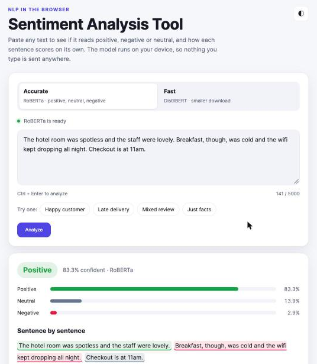

# Sentiment Analysis Tool

<p align="center">
  <a href="https://amatya27.github.io/sentiment-analysis-tool/"><b>Try it live</b></a> &nbsp;·&nbsp; runs fully in your browser, no server, no API key
</p>

<p align="center">
  <a href="https://amatya27.github.io/sentiment-analysis-tool/"></a>
</p>

Paste any text and it tells you whether it reads positive, negative or neutral, how confident it is and, for longer text, how each sentence scores on its own. I built it while exploring how text analysis could help with hiring workflows, like reading candidate feedback or interview notes.

## How it works

- **Model:** DistilBERT fine-tuned on SST-2 (`Xenova/distilbert-base-uncased-finetuned-sst-2-english`), run with [Transformers.js](https://github.com/xenova/transformers.js). The model downloads once and is cached by the browser, so everything after that runs on your own device. Nothing you type leaves the page.
- **Neutral:** SST-2 only knows positive and negative. If the model's top score is below 65%, I call it neutral instead of forcing a side.
- **Sentence by sentence:** one label for a whole paragraph can hide mixed feelings (a spotless room, but cold breakfast and bad wifi). For text with more than one sentence, it splits it with `Intl.Segmenter` and scores each sentence separately.

## Features

- Overall label, confidence bar and the raw model output
- Per-sentence breakdown for longer text
- Example texts to try in one click
- `Ctrl + Enter` to analyze
- Dark mode, remembered between visits

## Running it locally

It's a single `index.html`. Because it loads the model as an ES module, open it through a local server instead of double-clicking the file:

```bash
python -m http.server 8000
# then open http://localhost:8000
```

## Changes in 2026

- Removed a broken comment above `<!DOCTYPE html>` that pushed browsers into quirks mode.
- Removed a duplicate import of the library.
- Updated Transformers.js from 2.0.1 to 2.17.2.
- Added the sentence-by-sentence breakdown, confidence bar, example texts and keyboard shortcut.
- Replaced the pop-up alert with an inline message.
